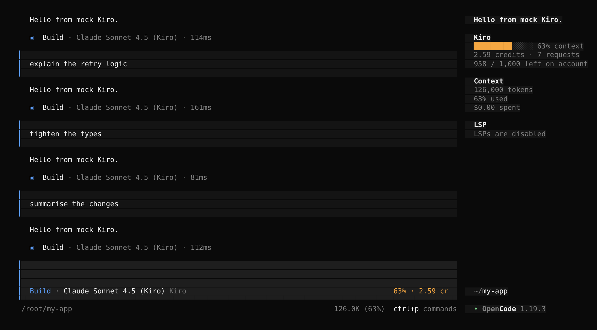

# opencode-kiro-provider

An [opencode](https://opencode.ai) plugin that adds **Kiro** (the AWS CodeWhisperer / Amazon Q Developer
backend behind the Kiro IDE and `kiro-cli`) as a model provider. Sign in once and use Kiro's models
(Claude Sonnet / Opus / Haiku, DeepSeek, GLM, MiniMax, Qwen, and `auto`) from opencode, billed against
your Kiro credits.

> **Unofficial.** Not affiliated with or endorsed by AWS or Kiro. It talks to the same private API the
> Kiro IDE uses, which can change without notice. Check that your Kiro plan permits this kind of use.

## Install

```sh
opencode plugin opencode-kiro-provider
```

That registers both halves of the plugin: the provider (in `opencode.json`) and the usage tracker
(in `tui.json`). To do it by hand, add the package to both files (project or `~/.config/opencode/`):

```jsonc
// opencode.json
{ "plugin": ["opencode-kiro-provider"] }

// tui.json: optional, for the usage tracker
{ "plugin": ["opencode-kiro-provider"] }
```

For a local checkout run `npm install && npm run build`, then point `opencode.json` at
`file:///path/to/kiro-opencode/dist/server.js` and `tui.json` at `file:///path/to/kiro-opencode/dist/tui.js`.

## Sign in

```sh
opencode auth login      # choose "Kiro"
```

| Method | Use when |
| --- | --- |
| **AWS Builder ID** | Personal / free Kiro account. Opens a browser device-login page. |
| **AWS IAM Identity Center** | Organization login. Asks for your start URL, region and (optionally) a profile ARN. |
| **Google account** / **GitHub account** | *Experimental.* Kiro's own browser sign-in. Kiro redirects back to `localhost:3128`, so that port must be free and the browser on the same machine. |
| **Import existing login** | You already ran `kiro-cli login` or signed in to the Kiro IDE (Linux, macOS, Windows). Nothing to approve. |

The Google/GitHub flow follows third-party documentation of Kiro's protocol, since Kiro doesn't publish it.
If it fails, signing in with the Kiro IDE and choosing *Import existing login* gives the same session.

Then pick a model with `/models` (e.g. `kiro/claude-sonnet-5`). Credentials live in opencode's normal
`auth.json`; access tokens are refreshed automatically and the rotated refresh token is written back.

### Usage tracker

With the TUI half installed (opencode 1.19+), Kiro sessions get a live tracker:



<sub>The real opencode 1.19 TUI, driven by the e2e mock server, so the figures are the mock's.</sub>

```
Kiro                                  ← sidebar
█████████░░░░░ 63% context            ← green / yellow ≥ 60% / red ≥ 85%
2.59 credits · 7 requests             ← charged to this session
958 / 1,000 left on account

┃  Build · Claude Sonnet 4.5 (Kiro)                  63% · 2.59 cr      ← beside the prompt
```

* **Context** is Kiro's own context-usage figure for the latest response.
* **Credits** are what Kiro metered for each response in this session, summed. That includes opencode's
  background requests (title generation, compaction).
* **Account** credits left are refreshed at most once a minute while you work (and whenever `kiro_usage` runs).
* When the account drops to 10% of its allowance or less, a warning toast appears, once per allowance period
  (and again if it runs out).
* **`/kiro`** (or *Kiro usage* in the command palette) opens the full figures: session context, credits and
  model, plus every account allowance with its reset date.

It updates as responses complete. Sessions on other providers show nothing. The provider writes the figures
to small files under opencode's state directory (`~/.local/state/opencode/kiro/`), which the TUI reads.
`["opencode-kiro-provider", { "tracker": false }]` in `opencode.json` stops recording; in `tui.json` it hides the views.

### Credits tool

The plugin adds a `kiro_usage` tool, so you can ask *"how many Kiro credits do I have left?"*. It reports
used and remaining credits (and free-trial credits) for the signed-in account.

### Thinking

For Claude models, opencode's reasoning variants (`ctrl+t`, or `--variant high`) switch on Kiro's thinking
mode. Thinking output is shown as reasoning.

## Configuration

Everything works without configuration.

### Models

After you sign in, the plugin asks Kiro which models your account can use, with their real context and
output limits, and caches the list. opencode reads models at startup, so newly available models appear from
the **next launch**; the list refreshes every 6 hours. Until the first discovery, a built-in list is offered.

`provider.kiro.models` in `opencode.json` is layered on top, to adjust a model or add one by its Kiro id:

```json
{
  "provider": {
    "kiro": {
      "models": {
        "claude-sonnet-5": { "limit": { "context": 200000, "output": 32000 } }
      }
    }
  }
}
```

### Plugin options

Options go in the plugin entry, e.g. `"plugin": [["opencode-kiro-provider", { "debug": true }]]`.

| Option | Where | Default | Effect |
| --- | --- | --- | --- |
| `profileArn` | `opencode.json` | – | Kiro profile for IAM Identity Center sessions that don't carry one (also `KIRO_PROFILE_ARN`). |
| `region` | `opencode.json` | `us-east-1` | Default Identity Center region offered at login. |
| `modelDiscovery` | `opencode.json` | `true` | `false` keeps the built-in model list. |
| `tracker` | both | `true` | `false` stops recording usage (`opencode.json`) or hides the tracker (`tui.json`). |
| `accountRefreshSeconds` | `opencode.json` | `60` | Minimum gap between account-credit refreshes. |
| `lowCredits` | `tui.json` | `0.1` | Warn at this fraction of the allowance left; `0` turns the warning off. |
| `debug` | `opencode.json` | `false` | Write the diagnostics log (also `KIRO_DEBUG=1`). |

### Environment

| Variable | Effect |
| --- | --- |
| `KIRO_DEBUG=1` | Diagnostics log (see below). |
| `KIRO_PROFILE_ARN` | As the `profileArn` option. |
| `KIRO_API_ENDPOINT`, `KIRO_AUTH_ENDPOINT`, `KIRO_SIGNIN_URL` | Send API, auth or sign-in traffic elsewhere (corporate proxy, the e2e mock server). |

## Troubleshooting

Run opencode with `KIRO_DEBUG=1` and reproduce the problem. The plugin writes
`~/.local/state/opencode/kiro/debug.log`: one JSON line per request, response, retry, token refresh and model
discovery. Each stream gets a summary of the event types Kiro sent, with the field names of any it doesn't
recognise. The log never contains prompts, replies, tool output or tokens, so it is safe to attach to an issue.

Common cases:

* **"Kiro rejected the credentials"**: the session has ended; run `opencode auth login` again.
* **"Kiro stopped mid-response…"**: Kiro failed partway through a reply. Failures before any output are
  retried automatically; this one happened after the reply had started.
* **A model you expect is missing**: discovery updates the list for the next launch. Restart opencode, or check
  `debug.log` for a `models.failed` line.

## How it works

```
opencode ──(@ai-sdk/openai-compatible, OpenAI chat format)──▶ plugin fetch ──▶ Kiro generateAssistantResponse
        ◀──────────── OpenAI SSE chunks ◀── AWS event-stream decoder ◀──────────────┘
```

* `config` hook declares the `kiro` provider and its models (it has no models.dev entry).
* `tool` hook adds `kiro_usage` (calls Kiro's `getUsageLimits`); `chat.headers` tags each Kiro request
  with its session so per-session credits can be tracked.
* A separate `./tui` entry registers the tracker views in the `sidebar_content` and `session_prompt_right`
  slots, using OpenTUI's element API (no JSX build step; the host supplies `@opentui/solid` and `solid-js`).
* `auth` hook provides the login methods and a `loader` that returns a custom `fetch`. That fetch converts
  OpenAI requests to Kiro's `conversationState` (history pairing, tool schemas, images, system prompt),
  authenticates and refreshes the token, retries 429/5xx with backoff, and converts the binary event stream
  back to OpenAI streaming chunks (text, reasoning, incremental tool calls, usage).
* Token counts are Kiro's own when it reports them (`metadataEvent`), otherwise estimated from its
  context-usage figure.
* Retries: throttling and server errors back off and retry, as do transient stream failures that happen before
  any output. A prompt that certainly exceeds the model's window gets the context-overflow error locally, so
  opencode compacts without a wasted request.
* opencode's background title requests never enable Kiro's thinking mode, so they don't spend extra credits.

## Limitations

* Built against the protocol the Kiro IDE uses, but not yet exercised against live AWS. It is covered by
  unit tests, and by end-to-end runs of the real opencode binary (1.19) against a mock Kiro server. Please
  report breakage with a `KIRO_DEBUG=1` log.
* Remote image URLs can't be forwarded (Kiro only accepts inline image bytes).
* Sampling parameters (temperature, top-p, max tokens) are not supported by Kiro and are ignored.
* Google/GitHub sign-in is experimental and needs `localhost:3128` free on the machine running opencode.
* Newly discovered models appear from the next launch (opencode 1.19 reads models at startup).

## Development

```sh
npm install
npm run typecheck && npm test && npm run build

# End-to-end: drives a real opencode binary against a local mock of Kiro (no AWS calls).
OPENCODE_BIN=$(command -v opencode) npm run test:e2e
```

The e2e suite (`e2e/run.sh` + `e2e/mock-kiro.ts`) covers model listing and discovery, streaming chat, a
tool-call round trip, the `kiro_usage` tool, thinking variants, token refresh and persistence, mid-stream errors,
context-overflow compaction, the debug log, device and Google sign-in through opencode's HTTP API, and (when
`tmux` is installed) the TUI tracker, low-credit warning and `/kiro` dialog in a real opencode TUI.

### Releasing

1. Add the release notes under a new version heading in `CHANGELOG.md`.
2. `npm version <patch|minor|major>`, then `git push --follow-tags`.
3. The *Release* workflow checks that the tag matches `package.json`, runs the checks, publishes to npm with
   provenance and creates the GitHub release from the changelog. It needs an `NPM_TOKEN` secret (an npm
   automation token) in a GitHub environment named `npm`.

Layout:

| Path | Purpose |
| --- | --- |
| `src/index.ts`, `src/server.ts` | Provider plugin: `config`, `auth`, `tool` and `chat.headers` hooks |
| `src/tui.ts`, `src/tracker/` | TUI usage tracker; the usage files it shares with the provider |
| `src/auth/` | Credential encoding, OIDC device flow + refresh, Google/GitHub sign-in, Kiro IDE / kiro-cli import, token manager |
| `src/transform/` | OpenAI ⇄ Kiro request/response translation and the AWS event-stream decoder |
| `src/fetch.ts` | The custom `fetch`: auth, retries, overflow guard, error mapping |
| `src/models.ts`, `src/usage.ts` | Model catalogue and live discovery; credit usage lookup |
| `src/debug.ts` | Opt-in diagnostics log |

Prior art studied for the design: [`opencode-kiro`](https://github.com/NachoFLizaur/opencode-kiro) (MIT, wraps
`kiro-cli` over ACP) and `opencode-kiro-auth` (GPL-3.0, direct API). This project is an independent MIT
implementation and does not copy code from the GPL project.

## Also in this repository

[`ghe-policy/`](ghe-policy/) is a separate plugin, `opencode-ghe-policy`, that makes a GitHub Enterprise
repository the control plane for opencode: central policy, command guardrails and commit provenance.

[`opencode-fork/`](opencode-fork/) builds a hardened opencode that makes no network calls the organization didn't
choose (no models.opencode.ai catalogue fetch, update checks, downloads or opencode.ai services), as eight patches
on a pinned upstream release, with tests that prove it.

## License

MIT
# Tools and plugins

A collection of standalone tools and editor/agent plugins. Each project lives in its own folder, has its own README, and is installed and tested independently.

## Catalog

| Project | Kind | What it does |
| --- | --- | --- |
| [`tools/ip-redactor`](tools/ip-redactor) | CLI (Python) | Structure-preserving IPv4/IPv6 redaction for configs, logs, Office/Visio files and packet captures. It is keyed and reversible, and subnets stay together. |
| [`tools/topomap`](tools/topomap) | CLI (Python) | Gathers network and AWS topology automatically (AWS APIs, AWS Organizations OUs and accounts, SSH crawl over CDP/LLDP, or saved command output and config backups), stitches on-prem to AWS, and draws it as draw.io, SVG, Mermaid or DOT. |

### In review ([PR #1](https://github.com/CorpLynx/kiro-opencode/pull/1))

These projects are still at the top level on their branch. They move into the layout below once that PR is merged.

| Project | Kind | What it does |
| --- | --- | --- |
| `plugins/opencode-kiro-provider` | OpenCode plugin (TS) | Adds Kiro (AWS CodeWhisperer / Amazon Q Developer) as a model provider, with sign-in and a live usage tracker. Published to npm as `opencode-kiro-provider`. |
| `plugins/opencode-ghe-policy` | OpenCode plugin (TS) | Makes a GitHub Enterprise repository the control plane for OpenCode: central policy plus command guardrails. |
| `builds/opencode-hardened` | Patched build | An OpenCode build that makes no network calls the organization didn't choose. It is a patch queue on a pinned upstream release. |

### Planned

| Project | Kind | Notes |
| --- | --- | --- |
| `plugins/opencode-ipredact` | OpenCode plugin | Keeps real addresses away from the model: messages are redacted before they are sent, and addresses are restored when tools run and in replies. Built on `tools/ip-redactor`. |
| `tools/ipam-infoblox` | CLI | Converts an AWS IPAM export into an Infoblox import, checking ranges against the Infoblox API first. |

## Layout

```
tools/<name>/            standalone tools (CLIs, libraries)
plugins/<host>-<name>/   plugins for a host app, e.g. plugins/opencode-ipredact
builds/<name>/           patched builds of third-party software
.github/workflows/ci.yml one CI job per project
```

Each project folder contains:

- **`README.md`**: what it does, how to install it, how to use it, and its limits.
- **Its own build manifest**: `pyproject.toml` for Python, `package.json` for TypeScript and JavaScript.
- **`tests/`**: tests runnable from inside the folder with a single command, which the README states.

Projects don't import from each other through relative paths. If a plugin needs a tool, it depends on the tool's installed package or CLI. That way every project can be installed on its own.

## Adding a project

1. Create `tools/<name>/`, `plugins/<host>-<name>/` or `builds/<name>/` with the files above.
2. Add a row to the catalog in this README.
3. Add an entry to the `project` matrix in `.github/workflows/ci.yml`.
4. Keep dependencies optional where you can. A Python tool's core should run on the standard library, with optional extras that add heavier features.

## Running tests

```sh
cd tools/ip-redactor
pip install '.[test]'
python3 -m unittest discover -s tests
```

CI runs the same command for every project on each push and pull request.
