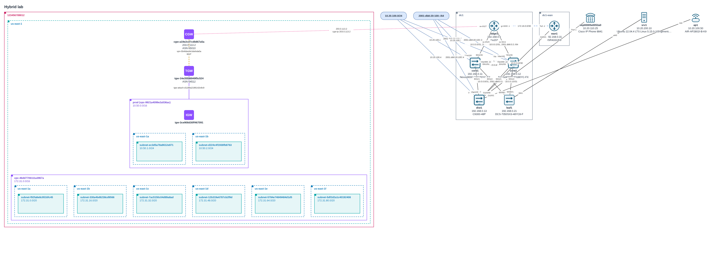

# topomap: network and AWS topology, gathered and drawn automatically

`topomap` builds topology diagrams from the network itself instead of from someone's memory. It collects from three kinds of source:

- **AWS:** read-only API calls across accounts and regions, including the AWS Organization itself (OUs, accounts, SCPs and other policies), collected from the management account.
- **Network devices:** an SSH crawl that follows CDP/LLDP neighbours.
- **Files you already have:** saved `show` output and config backups, from RANCID, Oxidized or a folder of captures.

It links on-prem devices to their AWS VPN and Direct Connect edges, then draws the result as **draw.io** (with the official AWS and Cisco icons), **SVG**, **Mermaid** or **Graphviz DOT**.



<sub>Drawn by `topomap render` from the test fixtures (mocked AWS plus made-up device output).</sub>

```
collect ─┬─ aws      boto3, read-only                       ┐
         ├─ aws-org  OUs, accounts, policies                │
         ├─ files    saved "show" output / config backups   ├─▶ topology JSON ─▶ merge ─▶ filter ─▶ render
         └─ devices  SSH crawl over CDP/LLDP, read-only     ┘                     diff (drift between snapshots)
```

Every stage reads and writes the same JSON, so stages chain through files or pipes. The JSON is sorted with stable IDs, so snapshots can be committed to git and compared.

## Install

```sh
pip install './tools/topomap[all]'    # AWS + SSH crawling
pip install ./tools/topomap           # files, merge, diff, filter, render: no dependencies
```

| Extra | Adds | Needs |
| --- | --- | --- |
| *(none)* | `collect files`, `merge`, `diff`, `filter`, `render` (all formats) | Python 3.9+ standard library |
| `aws` | `collect aws` | `boto3` |
| `devices` | `collect devices` | `netmiko` |

## Quick start

```sh
# 1. Gather
topomap collect aws-org --profile management -o org.json        # the organization chart
topomap collect aws --profile prod --region us-east-1 --region eu-west-1 -o aws.json
topomap collect files ~/rancid/configs ~/captures --l3-exclude 192.168.0.0/24 -o net.json
#    or crawl live:
TOPOMAP_USERNAME=netops topomap collect devices --seed 10.0.0.1 --allow 10.0.0.0/16 --ask-pass -o net.json

# 2. Combine: accounts land in their OUs; on-prem devices are linked to their
#    AWS customer gateways and DX VIFs
topomap merge org.json aws.json net.json -o all.json
topomap render org.json -o organization.drawio                 # or just the org chart

# 3. Draw (format from the extension)
topomap render all.json -o network.drawio
topomap filter all.json --aws-only --collapse vpc | topomap render - -o aws-overview.svg

# 4. Later: what changed?
topomap diff last-month.json all.json      # exit status 1 if anything did
```

## Collecting

### AWS (`collect aws`)

- **What it collects:**
  - accounts, regions and VPCs;
  - subnets, drawn inside their AZs, with public/private detection and routes;
  - internet, egress-only and NAT gateways;
  - transit gateways, with their route tables and attachments;
  - VPC peering, VPN gateways and customer gateways;
  - VPN connections, with tunnels;
  - Direct Connect connections, gateways, virtual interfaces and associations.
  - With `--include instances,endpoints`, also EC2 instances and VPC endpoints.
- **Read-only, enforced in code.** Every boto3 client is wrapped so only `Describe*`/`List*`/`Get*`/`Search*` calls can run. The only exception is STS `AssumeRole`, on the client that fetches credentials for other accounts.
- **Several accounts:**
  - `--profile` (repeatable) uses your own profiles.
  - `--role-arn` (repeatable) assumes roles from a hub account. With it, only the accounts behind the roles are collected.
  - `--org-role-name NAME` assumes `role/NAME` in every active account of your AWS Organization.
- **Speed:** regions and accounts are collected in parallel (`--workers`).
- **Failures:** a denied region or service becomes one warning and the rest is still collected.
- **Empty regions are left out,** so an account shows only the regions where something was found. A region that couldn't be fully read is kept and marked `incomplete`.
- **Peers outside the collected estate** (a VPC in another account, a TGW peer) get a dashed placeholder.
- VPN pre-shared keys and customer gateway configurations are never read.

### AWS Organizations (`collect aws-org`)


<sub>Drawn from a mocked organization.</sub>

- **Run it against the management account,** or an account that is a delegated administrator for AWS Organizations. Only those can list the whole organization. A member account gets a clear error saying so.
- **Permissions:** the AWS-managed `AWSOrganizationsReadOnlyAccess` policy is enough. Like `collect aws`, it can only call `Describe*`/`List*`/`Get*`, plus `AssumeRole` with `--role-arn`.
- **What it collects:**
  - the organization, its root and the enabled policy types;
  - every OU, nested to any depth, with its path (`Root/Workloads/Prod`);
  - every account, with its name, status (suspended accounts are labelled), how and when it joined, and which one is the management account;
  - delegated administrators and the services they administer;
  - organization policies (SCPs, RCPs, tag, backup, AI opt-out, chatbot and declarative policies) on the root, OUs and accounts they're attached to.
- **Policies** (`--policies`):
  - `attrs` (default): policies are attributes, and SCPs are written under each OU.
  - `nodes`: also draws each policy as a box with lines to its targets.
  - `none`: leaves policies out.
  - AWS-managed policies such as `FullAWSAccess` are attached everywhere, so they're hidden unless you add `--include aws-managed-policies`.
- **Extras** (`--include`):
  - `tags`: account tags, one API call per account.
  - `emails`: account email addresses. These are personal data, so they're off by default.
- **Combining with network data:** `collect aws` gives each account the same ID, so `merge org.json aws.json` draws each account inside its OU, with its regions and VPCs inside the account. An account with nothing collected inside it is drawn as an account icon; one holding VPCs is drawn as a container.

### Saved output and configs (`collect files`)

- **Platforms:** Cisco IOS/IOS-XE, Cisco NX-OS, Arista EOS and Juniper Junos.
- **What it reads:**
  - captures with prompts (`core1#show cdp neighbors detail`, `netops@edge1> show lldp neighbors`) or with banners (`===== show version =====`);
  - abbreviated commands (`sh cdp nei det`);
  - running configs: IOS/NX-OS/EOS style, and Junos in both `set` and curly-brace style.
- **Commands understood:** `show version`, `show cdp neighbors detail`, `show lldp neighbors [detail]`, `show ip interface [brief]` / `show ipv6 interface`, `show interfaces terse`, `show hostname`, `show chassis hardware`, and configurations.
- **Several files per device:** a capture and a config for the same device are merged into one.
- **Sites:** `--site NAME`, or `--site-map sites.csv` (`hostname,site`, with `*` wildcards).
- **Layer 3:** a subnet shared by two devices becomes a link, or is added to their cable if there is one. A subnet shared by three or more becomes a segment. Use `--l3-exclude` for the management network, which otherwise connects everything to everything.

### Live crawl (`collect devices`)

- **What it does:** logs into `--seed` devices (or an `--inventory` CSV/JSON) over SSH and runs the same read-only commands. It then follows CDP/LLDP neighbours breadth-first.
- **Safety:**
  - **It only crawls beyond the seeds into `--allow` ranges.** Without `--allow`, only the seeds are contacted.
  - Depth is limited by `--max-depth`, and neighbours that look like phones, APs or servers are skipped (`--skip-role`).
  - Every command is checked against the per-platform allowlist before anything is sent. Only `show` commands are allowed, with no pipes.
  - **Passwords** come only from `$TOPOMAP_PASSWORD` or an `--ask-pass` prompt, never from the command line or an inventory file. Keys in the SSH agent or given with `--key-file` work too.
  - `--strict-host-keys` refuses devices whose host key isn't in `~/.ssh/known_hosts`. Without it, netmiko accepts any key.
- **Autodetection:** when the platform isn't given, it is autodetected with netmiko, which sends a few probe commands of its own. Set `--platform` or put platforms in the inventory to avoid that.
- `--save-raw DIR` keeps each device's output (mode 0600) in the format `collect files` reads, so a crawl can be replayed offline.

## Combining, trimming and comparing

- **`merge`** unions topologies, then stitches each on-prem device to:
  - an AWS customer gateway whose IP is one of the device's addresses;
  - the Direct Connect connection of a VIF whose customer address is one of the device's addresses;
  - anything you pair by hand with `--stitch device=node`, for gateways behind NAT. Gateways that match nothing are listed in a warning.
- **`filter`** shrinks big estates down to a readable picture. It takes `--aws-only` / `--network-only`, `--kind`, `--exclude-kind az` (children move up), `--collapse vpc` (subnets fold into their VPC, and links are re-pointed), `--around core1 --depth 2` and `--match REGEX`.
- **`diff`** shows what was added, removed and changed, down to the attribute (`interfaces[Gi1/0/1].addresses: +10.0.0.9/30`). It writes text or JSON, and exits 1 when anything changed, so it can watch for drift in CI.

## Drawing (`render`)

| Format | Notes |
| --- | --- |
| `drawio` | Opens in draw.io / diagrams.net and can be exported to Visio. Uses draw.io's built-in AWS 2021 and Cisco 19 shapes, with nested containers (account › region › VPC › AZ › subnet; site › device). Written as uncompressed XML, so it diffs cleanly and can be redacted as text. |
| `svg` | Standalone, uses the same layout and needs no Graphviz. |
| `mermaid` | Paste into GitHub or GitLab Markdown, Notion, etc. |
| `dot` | For Graphviz (`dot -Tpng`). |

- **Layout:** read top to bottom: internet, then edge gateways and firewalls, then routers, core switches, access switches and endpoints.
- **Output is deterministic:** the same input gives byte-identical output.
- **Options:** `--direction LR` reads left to right, `--title` adds a title, and `--no-link-labels` drops port and subnet labels.

### Keep collected data out of git

Topology JSON and diagrams describe real networks: account IDs, ARNs, addresses and tags. Write them outside the repo, or in `tools/topomap/`, where `.gitignore` keeps `*.json`, `*.drawio`, `*.svg`, `*.mmd`, `*.dot`, `*.png` and `out/` from being committed.

### Sharing diagrams safely

Diagrams are full of addresses. The draw.io, SVG, Mermaid and DOT outputs are plain text, and so is the topology JSON. That means [`tools/ip-redactor`](../ip-redactor) can redact them, keeping the structure, before you send them to a vendor:

```sh
ipredact network.drawio -o network.redacted.drawio --key-file redact.key
```

## Limits

- **Lines are straight.** In dense areas they can cross icons and other containers, and port labels can overlap. Tidy up in draw.io if it matters.
- **Junos crawling:** Junos has no `show lldp neighbors detail` for all interfaces, so the crawler can't follow Junos neighbours by address. They are still drawn.
- **Not parsed yet:** CDP/LLDP summary tables on Cisco and Arista (only the `detail` forms), Junos `groups`/`apply-groups`, and SNMP.
- **AWS resources not collected:** DX LAGs, TGW Connect peers, Cloud WAN, load balancers and security groups. From Organizations: policy contents (only names and attachments), and SCP effects on accounts.
- **Untested against real equipment:** the device parsers were written from known output formats and tested against made-up captures, not real devices. Please report output that doesn't parse.

## Development

```sh
pip install './tools/topomap[test]'
cd tools/topomap && python3 -m unittest discover -s tests
```

[DESIGN.md](DESIGN.md) is the contract between the stages: IDs, kinds, attributes, containment and the stitching rules. `tests/test_e2e.py` runs every stage through the CLI, from mocked AWS plus the device fixtures in `tests/fixtures/devices/` (a made-up multi-vendor lab) to every output format.
