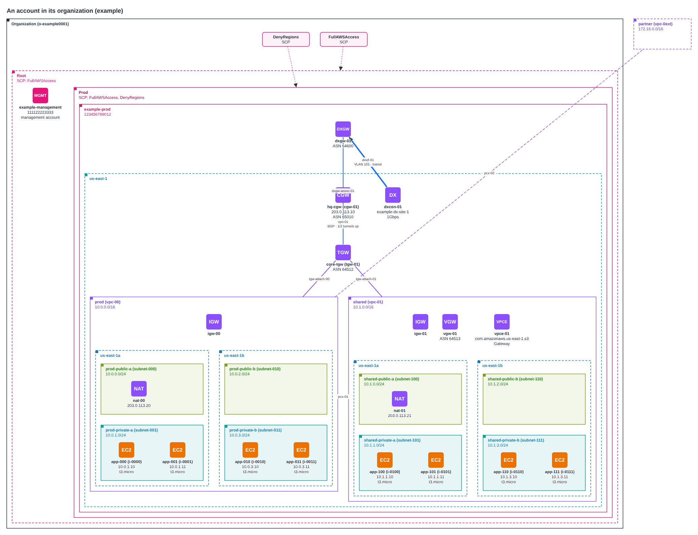
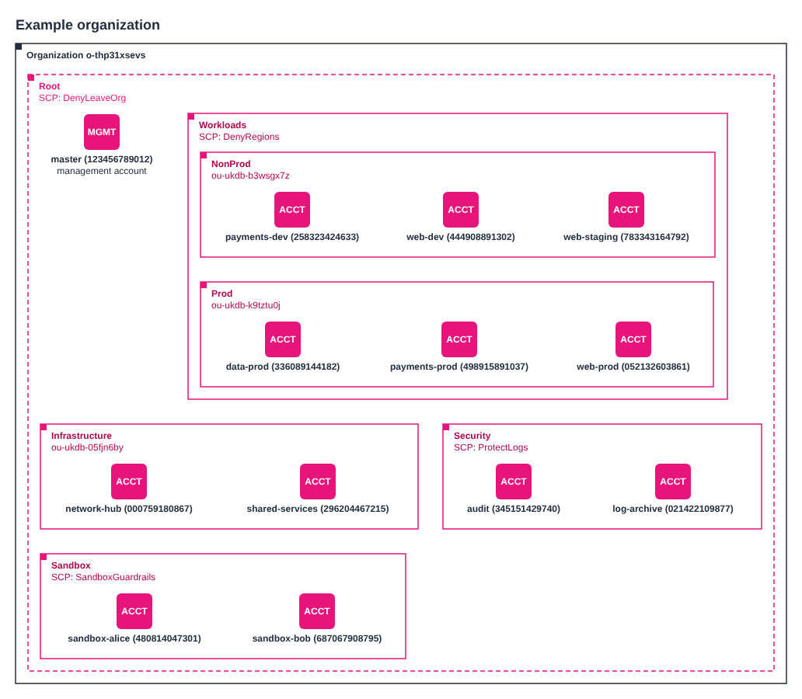

# topomapper: AWS topology, gathered and drawn automatically

`topomapper` builds AWS topology diagrams from the accounts themselves instead of from someone's memory. It makes read-only API calls across accounts and regions, including the AWS Organization itself (OUs, accounts, SCPs and other policies), collected from the management account. On request it also collects the Bedrock models each account can use, its custom IAM roles and users, EKS clusters, or every resource in the account.

It merges what it collected into one picture and draws it as **draw.io** (with the official AWS icons), **SVG**, **Mermaid** or **Graphviz DOT**.



<sub>Drawn by `topomapper diagram draw` from the test fixtures (a made-up organization and account).</sub>

```
account collect  read-only API calls (boto3)  ─┐
org collect      OUs, accounts, policies      ─┴─▶ topology JSON ─▶ topology merge ─▶ topology filter ─▶ diagram draw
                                                                 └─▶ topology diff (drift between snapshots)
```

Every stage reads and writes the same JSON, so stages chain through files or pipes. The JSON is sorted with stable IDs, so snapshots can be committed to git and compared.

## Install

```sh
pip install './tools/topomapper[aws]'    # AWS collection
pip install ./tools/topomapper           # topology and diagram commands: no dependencies
```

Install it from this repository as shown. **`pip install topomapper` from PyPI won't work** (it isn't published there), and **`pip install topomap` installs someone else's project**: this tool was called `topomap` until that clash was found, and was renamed. Old snapshots (schema `topomap/1`) still load.

| Extra | Adds | Needs |
| --- | --- | --- |
| *(none)* | `topomapper topology …` and `topomapper diagram draw` (all formats) | Python 3.9+ standard library |
| `aws` | `topomapper account collect`, `topomapper org collect` | `boto3` |

## Quick start

Commands read like the AWS CLI: `topomapper GROUP VERB`, then the words that say what to collect, then the files to write. Each file's extension says what goes in it:

```sh
topomapper account collect --profile prod prod.drawio             # an AWS account's networks, drawn
topomapper account collect network iam --profile prod prod.svg    # ...with its IAM roles and users
topomapper org collect --profile management org.svg                # the organization chart
```

To combine runs, keep each one's topology (`.json`) and merge them. Accounts land in their OUs:

```sh
topomapper org collect --profile management org.json
topomapper account collect --profile prod --region us-east-1 --region eu-west-1 prod.json

topomapper topology merge org.json prod.json --to all.json all.drawio   # keep the result, and draw it
topomapper topology filter all.json --collapse vpc overview.svg
topomapper topology diff last-month.json all.json                        # later: what changed? (exit 1 if anything did)
```

### Commands

| Command | Does |
| --- | --- |
| [`account collect`](#topomapper-account-collect) | Collect AWS accounts: their networks (VPCs, subnets, gateways, TGWs, VPN, Direct Connect), and on request IAM, EKS, Bedrock or every resource |
| [`org collect`](#topomapper-org-collect) | Collect the AWS Organization: OUs, accounts, policies, delegated admins |
| [`topology merge`](#topomapper-topology-merge) | Combine topologies into one |
| [`topology filter`](#topomapper-topology-filter) | Cut a topology down to what you want to draw |
| [`topology diff`](#topomapper-topology-diff) | Show what changed between two snapshots |
| [`topology anonymize`](#topomapper-topology-anonymize) | Replace IDs, names and addresses with fakes, for sharing |
| [`diagram draw`](#topomapper-diagram-draw) | Draw a topology saved earlier |

Every word and flag is listed under [Command reference](#command-reference); `topomapper GROUP VERB --help` shows the same.

- **What to collect is said in words,** not flags: `topomapper account collect network iam eks`. With no words, `account collect` collects the network.
- **Files to write come last,** and each one's extension picks what's written: `.json` writes the topology, and `.drawio`, `.svg`, `.mmd` or `.dot` draws it. Name several to write several at once. With none, the topology JSON goes to stdout, so commands chain with pipes (`topomapper account collect | topomapper topology filter - --kind vpc view.svg`). `topology merge` takes any number of inputs, so its files to write follow `--to`.
- **Drawing options** (`--direction LR`, `--title`, `--no-link-labels`) work on every command that writes a diagram.
- **A misspelt word or an unknown extension is refused straight away,** before a long collection starts.

## Collecting

### AWS accounts (`topomapper account collect`)

- **What it collects:**
  - accounts, regions and VPCs;
  - subnets, drawn inside their AZs, with public/private detection and routes;
  - internet, egress-only and NAT gateways;
  - transit gateways, with their route tables and attachments;
  - VPC peering, VPN gateways and customer gateways;
  - VPN connections, with tunnels;
  - Direct Connect connections, gateways, virtual interfaces and associations.
  - With the words `instances` and `endpoints`, also EC2 instances and VPC endpoints.
  - Tags are left out by default, since they are free text (project names, owners). Add the word `tags` to keep them. A resource's Name tag still labels it.
  - Every region enabled for the account is walked unless you pass `--region`. `meta.region_source` records how the list was chosen: `--region`, `describe-regions`, `fallback` (the region listing was denied, so `us-east-1` only) or `mixed`.
- **Read-only, enforced in code.** Every boto3 client is wrapped so only `Describe*`/`List*`/`Get*`/`Search*` calls can run. The only exception is STS `AssumeRole`, on the client that fetches credentials for other accounts.
- **Several accounts:**
  - `--profile` (repeatable) uses your own profiles.
  - `--role-arn` (repeatable) assumes roles from a hub account. With it, only the accounts behind the roles are collected.
  - `--org-role-name NAME` assumes `role/NAME` in every active account of your AWS Organization.
- **Speed:** regions and accounts are collected in parallel (`--workers`).
- **Failures:** a denied region or service becomes one warning and the rest is still collected.
- **Regions blocked by an SCP:** when a service control policy explicitly denies EC2, EKS, Bedrock or Direct Connect in a region, that is recognised by the error text, reported once per service and region, and recorded on the region as `scp_denied`. The diagram labels it `SCP blocks EC2, EKS`, and `topology filter --hide-empty` drops it.
- **Peers outside the collected estate** (a VPC in another account, a TGW peer) get a dashed placeholder.
- VPN pre-shared keys and customer gateway configurations are never read.

### GovCloud and other partitions

topomapper works in the AWS GovCloud (US) partition. Credentials only work in their own partition, so a GovCloud profile is separate from a commercial one.

```sh
topomapper org collect --profile gov-management topomapper-out/gov-org.json
topomapper account collect network iam --profile gov-management \
    --region us-gov-west-1 --region us-gov-east-1 topomapper-out/gov.json
```

- **Home region:** with no `--region` and no region in the profile, topomapper tries the commercial, GovCloud and China starting regions in turn, so the partition is found from the credentials. Give `--region us-gov-west-1` to skip the probing.
- **Regions:** `describe-regions` lists `us-gov-east-1` and `us-gov-west-1`. If that listing is denied, the fallback is `us-gov-west-1`.
- **Service lookups:** whether Bedrock or EKS exists in a region is checked in that region's own partition. GovCloud has both in `us-gov-west-1` and `us-gov-east-1`.
- **ARNs:** `--role-arn` and `--org-role-name` use the partition the credentials belong to (`arn:aws-us-gov:...`).
- **Merging:** account IDs in GovCloud and commercial are different accounts, so merging both into one diagram is safe. Nothing links the two partitions.
- **Tested with an emulator only.** The GovCloud code paths are exercised against moto in `us-gov-west-1` and with stubbed partition lookups, never against a real GovCloud account. Please report anything that behaves differently there. Bedrock availability in GovCloud follows the same API but I haven't seen real GovCloud answers.

### Bedrock, IAM and EKS (`bedrock`, `iam`, `eks`)

Three more parts of `topomapper account collect` cover what the network doesn't. Name them after `collect`, with `network` if you want the network too. Each is read-only and works across every account the command reaches (`--org-role-name` for the whole organization).

| Part | Adds | Needs (read-only) |
| --- | --- | --- |
| `bedrock` | A **Bedrock** group in each account and region where Bedrock exists. It holds a node for each foundation model that is **in use** (CloudWatch has Bedrock metrics for it in the last 14 days) or **granted** (an IAM policy in that account allows invoking it by name or pattern), plus the account's custom and imported models. A model nobody can call, because its agreement isn't in place, is marked `not invocable`. A policy granting every model is recorded on the box (`granted_all_to`), not drawn as hundreds of nodes. The list of models Bedrock offers in the region is only a count. Regions without Bedrock aren't asked. | `bedrock:ListFoundationModels`, `GetFoundationModelAvailability`, `ListCustomModels`, `ListImportedModels`, `ListProvisionedModelThroughputs`, `cloudwatch:ListMetrics`, `iam:GetAccountAuthorizationDetails` |
| `iam` | One node per **custom IAM role** and **user**, in an **IAM box** that is always drawn in the account's top-right corner. For a role: who may assume it (accounts, services, federated providers, or anyone), policy names, permissions boundary, last use. For a user: groups, policy names, whether MFA is on, and the status and age of access keys. Roles that trust a principal in another collected account get a drawn **trust link**. Service-linked roles and Identity Center roles are left out unless you add `--all-roles`. No policy documents, key IDs or credentials are read. | `iam:GetAccountAuthorizationDetails` (falls back to `ListRoles` and `ListUsers`), `ListMFADevices`, `ListAccessKeys` |
| `eks` | An **EKS cluster** node in its VPC: version, status, whether the API endpoint is public or private, logging, IAM role, OIDC issuer, node groups, Fargate profiles and add-ons. Pods and namespaces need the Kubernetes API and aren't collected. | `eks:ListClusters`, `DescribeCluster`, `ListNodegroups`, `DescribeNodegroup`, `ListFargateProfiles`, `DescribeFargateProfile`, `ListAddons` |

Leave out `network` (`topomapper account collect iam`) to skip the VPC, gateway, TGW, VPN and Direct Connect collection, for a faster run when you only want these. Regions with nothing to show are then dropped from the output.

**Why "in use or granted" and not "enabled":** Bedrock now switches most models on for every account, and its availability API says the same about all of them (an Anthropic model additionally needs a use-case form and, for some providers, an agreement). So availability can't tell one account from another. Usage and IAM grants can. Grants mean "an Allow statement exists": deny statements and permission boundaries aren't evaluated, so a grant doesn't prove a call would succeed. Usage only reaches back as far as CloudWatch keeps it (about two weeks).

Bedrock access was written against the API's documentation, checked once against a real account, and tested with stubbed answers, because the test AWS emulator has no Bedrock. Please report anything that doesn't match what the console shows.

An organization-wide picture of which accounts can use which models:

```sh
topomapper org collect --profile management topomapper-out/org.json
topomapper account collect bedrock --profile management \
    --org-role-name OrganizationAccountAccessRole topomapper-out/ai.json
topomapper topology merge topomapper-out/org.json topomapper-out/ai.json --to topomapper-out/org-ai.json
topomapper topology filter topomapper-out/org-ai.json --kind bedrock-model --hide-empty \
    topomapper-out/models.json topomapper-out/models.svg
```

`topology filter --kind bedrock-model` keeps the models and everything above them (region, account, OU, organization). The same works for `--kind iam-role --kind iam-user` (an IAM view with trust links) and `--kind eks-cluster`. Roles, users and cluster names identify an estate, so `topomapper topology anonymize` replaces them (and `--strict` drops everything else but a short list of facts).

### Every resource in an account (`resources`)

`topomapper account collect network resources` draws everything in the account, not only the network: every Lambda function, bucket, queue, table, key, role, log group and the rest, each with its service's AWS icon.

```sh
topomapper account collect network resources --profile prod topomapper-out/everything.json
topomapper topology filter topomapper-out/everything.json --max-per-type 10 topomapper-out/everything.drawio
```

- **Where the list comes from.** AWS has no single "list everything" call, so each region is asked through whichever inventory service the account has turned on, and the answers are combined by ARN:
  - **AWS Config**, if a recorder is recording (Control Tower turns it on in governed regions). Config also gives each resource's relationships, which is what puts a resource in its VPC or subnet.
  - **Resource Explorer**, if the region has an index and a default view. It lists untagged resources too.
  - If neither is on in a region, a **fallback** lists about fifty common resource types with Cloud Control, plus anything tagged, through the tagging API. That can miss types, so there's one warning per account naming the regions. Turning on Resource Explorer (one click, all regions, no charge) gives the complete list.
  - Each region records what it used in `inventory_sources`.
- **Where each resource is drawn:**
  - A resource the network collection already draws (VPC, subnet, instance, gateway) keeps its node, and IAM roles and EKS clusters from `iam` and `eks` keep theirs.
  - When Config says a resource is in one subnet, it's drawn in that subnet. When it spans several subnets (a Lambda function, a load balancer) or names only a VPC (a security group), it's drawn in the VPC.
  - Everything else goes in a box for its service in its region ("Lambda · 12 resources"), or in the account for global services such as IAM, CloudFront and Route 53.
- **Relationships:** the word `relationships` also draws Config's relationships between resources ("Is associated with Role") as thin dashed arrows. Relationships that placed a resource aren't drawn twice.
- **Big accounts:** the JSON keeps every resource. `topology filter --max-per-type N` draws a box's resources of one type as one node (`286 × certificate`) wherever there are more than N, which keeps a few thousand resources readable.
- **Permissions:** the AWS-managed `ReadOnlyAccess` policy covers all of it: `config:DescribeConfigurationRecorderStatus` and `config:SelectResourceConfig`, `resource-explorer-2:GetIndex`, `GetDefaultView` and `ListResources`, and for the fallback `cloudformation:ListResources` (with the services' own list permissions) and `tag:GetResources`. `SelectResourceConfig` is read-only but isn't named `Describe`/`List`/`Get`/`Search`, so it's allowed by name on the Config client only.
- **With `network`** you get the full VPC picture with resources placed in it. With `resources` alone, VPCs and subnets come from the inventory itself and are still drawn as VPCs and subnets.
- **Not collected:** resource configurations (only identity, type, tags and relationships), and resources Config and Resource Explorer don't record or index. Config's compliance and inventory reports aren't resources and are left out.

### AWS Organizations (`topomapper org collect`)



<sub>Drawn from a mocked organization.</sub>

- **Run it against the management account,** or an account that is a delegated administrator for AWS Organizations. Only those can list the whole organization. A member account gets a clear error saying so.
- **Permissions:** the AWS-managed `AWSOrganizationsReadOnlyAccess` policy is enough. Like `account collect`, it can only call `Describe*`/`List*`/`Get*`, plus `AssumeRole` with `--role-arn`.
- **What it collects:**
  - the organization, its root and the enabled policy types;
  - every OU, nested to any depth, with its path (`Root/Workloads/Prod`);
  - every account, with its name, status (suspended accounts are labelled), how and when it joined, and which one is the management account;
  - delegated administrators and the services they administer;
  - organization policies (SCPs, RCPs, tag, backup, AI opt-out, chatbot and declarative policies) on the root, OUs and accounts they're attached to.
- **Policies:** by default they're attributes, and SCPs are written under each OU. The word `policy-nodes` also draws each policy as a box with lines to its targets, and `no-policies` leaves them out. AWS-managed policies such as `FullAWSAccess` are attached everywhere, so they're hidden unless you add `aws-managed-policies`.
- **Extras:**
  - `tags`: account tags, one API call per account.
  - `emails`: account email addresses. These are personal data, so they're off by default.
- **Combining with network data:** `account collect` gives each account the same ID, so `topology merge org.json prod.json` draws each account inside its OU, with its regions and VPCs inside the account. After a merge, an account that `account collect` could not reach is labelled "not collected", an empty OU "empty" and a region with nothing in it "no resources", so a bare box is never mistaken for an unscanned one. An account with nothing collected inside it is drawn as an account icon; one holding VPCs is drawn as a container.

## Combining, trimming and comparing

- **`topology merge`** unions topologies: accounts land in their OUs, and anything collected twice becomes one node. Nodes that disagree about their kind or parent are listed in a warning.
- **`topology filter`** shrinks big estates down to a readable picture. It takes `--aws-only`, `--kind`, `--exclude-kind az` (children move up), `--collapse vpc` (subnets fold into their VPC, and links are re-pointed), `--max-per-type N` (more than N resources of one type in a box become one counted node), `--around tgw-01 --depth 2`, `--match REGEX` and `--hide-empty` (drops regions and OUs in which nothing was found).
- **`topology diff`** shows what was added, removed and changed, down to the attribute (`tags.Owner: net → platform`). It writes text or JSON, and exits 1 when anything changed, so it can watch for drift in CI.

## Drawing (`diagram draw`)

| Format | Notes |
| --- | --- |
| `drawio` | Opens in draw.io / diagrams.net and can be exported to Visio. Uses draw.io's built-in AWS 2021 shapes, with nested containers (account › region › VPC › AZ › subnet). Written as uncompressed XML, so it diffs cleanly and can be redacted as text. |
| `svg` | Standalone, uses the same layout and needs no Graphviz. |
| `mermaid` | Paste into GitHub or GitLab Markdown, Notion, etc. |
| `dot` | For Graphviz (`dot -Tpng`). |

- **Layout:** read top to bottom: the internet and on-premises ends (customer gateways, Direct Connect), then transit and Direct Connect gateways, then the VPCs, with public subnets above private ones and AZs side by side. Boxes with no lines between them (service boxes from `resources`, regions, OUs) are packed around the network like tiles, biggest first, so an account with dozens of services stays compact. The IAM box always sits in the account's top-right corner.
- **Output is deterministic:** the same input gives byte-identical output.
- **Options:** `--direction LR` reads left to right, `--title` adds a title, and `--no-link-labels` drops port and subnet labels.

### Sharing and committing output safely

Snapshots and diagrams carry account IDs, names, tags and addresses from the real estate. Two things help:

- **Keep real output out of git.** Write it under `topomapper-out/`, which the repo ignores (`topomapper-out/all.json`; the folder is created for you). Real output is written readable by you only (mode 0600). If it lands inside a git repository that doesn't ignore it, topomapper prints a note. That covers the files a command writes and a redirected stdout (`> out.json`).
- **`topology anonymize` makes a shareable copy.** Draw from the anonymized JSON and the diagram is safe too:

```sh
topomapper topology anonymize topomapper-out/all.json sample.json sample.svg
```

  It replaces account, organization, OU and resource IDs (same prefix and length), names and tag values (`account-1`, `ou-2`), descriptions, serial numbers, source file names, e-mail addresses and MAC addresses. The same real value always gets the same fake, and parent/child structure is kept. Nothing maps back, because no table or key is written. If any original ID is still in the output, there's a warning.
  - **Addresses:** `--ips ipredact` (the default) runs the addresses through [`tools/ip-redactor`](../ip-redactor), keeping subnets and containment true. Install it first (`pip install ./tools/ip-redactor`); without it, the command stops with that instruction. `--ips public` needs nothing: it moves only public addresses into the documentation ranges and leaves private ones as they are. `--ips keep` leaves all of them. `--ip-key-file` gives the same addresses on every run.
  - **`--keep-names`** leaves names and tag values alone; IDs and addresses are still replaced.
  - **`--strict`** also drops every attribute that isn't on the list of known, non-free-text ones (tags, descriptions, serials, anything unfamiliar). Use it when you don't know what a field might contain.
  - **Checks:** the output is searched for the original IDs, names and public addresses, and anything that survived is a warning. Fakes never equal a real value, and link order stays canonical, so `topology diff` and `topology merge` work on anonymized snapshots.

The text outputs (draw.io, SVG, Mermaid, DOT) can also be run through `ipredact` directly, but that doesn't touch IDs or names.

## Command reference

Every command prints this with `topomapper GROUP VERB --help`. Flags marked *repeatable* can be given several times. Words and files can come before or after the flags.

### Options shared by every command that makes a topology

`account collect`, `org collect`, `topology merge`, `topology filter` and `topology anonymize` all take these:

| Flag | What it does |
| --- | --- |
| `--direction {TB,LR}` | Diagram reading order: top-to-bottom (default) or left-to-right. |
| `--title TITLE` | Title drawn above the diagram. |
| `--no-link-labels` | Leave ports, subnets and VPN/VIF IDs off the links. |

They only matter when a file to write is a diagram. The files to write are named by extension: `.json` writes the topology; `.drawio`, `.svg`, `.mmd`/`.mermaid` or `.dot`/`.gv` draws it. With none, the topology JSON goes to stdout. Any other extension is refused before anything runs. Files are written readable by you only (mode 0600), except from `topology anonymize`.

### `topomapper account collect`

Collect from one or more AWS accounts, read-only. Details: [AWS accounts](#aws-accounts-topomapper-account-collect).

```
topomapper account collect [PART ...] [FILE ...] [--profile NAME] [--region NAME]
                           [--role-arn ARN | --org-role-name NAME] [--all-roles]
```

| Word or flag | What it does |
| --- | --- |
| `network` | VPCs, subnets, gateways, transit gateways, VPNs, peering and Direct Connect. Collected when no part is named. |
| `iam` | Custom IAM roles and users: trust, policy names, MFA and access-key age. No credentials or policy documents are read. See [Bedrock, IAM and EKS](#bedrock-iam-and-eks-bedrock-iam-eks). |
| `eks` | EKS clusters: version, endpoint access, node groups, Fargate profiles and add-ons. |
| `bedrock` | The Bedrock models each account uses or is granted, per region. |
| `resources` | Every resource in the account, from AWS Config and Resource Explorer, placed in its VPC or subnet when known. See [Every resource](#every-resource-in-an-account-resources). |
| `instances` | EC2 instances, in their subnets (implies `network`). |
| `endpoints` | VPC endpoints (implies `network`). |
| `tags` | Keep resource tags. |
| `relationships` | With `resources`, draw AWS Config's relationships between resources. |
| `FILE` | Files to write, by extension (see above). |
| `--profile NAME` | AWS profile to use. Repeatable, for several accounts. Default: boto3's credential chain. |
| `--region NAME` | Region to collect. Repeatable. Default: every region enabled for the account. |
| `--role-arn ARN` | Assume this role from each profile and collect its account. Repeatable. The profiles' own accounts are then left out unless `--org-role-name` covers them. |
| `--external-id ID` | External ID to pass when assuming roles. |
| `--role-session-name NAME` | Session name for assumed roles (default: `topomapper`). |
| `--org-role-name NAME` | List the organization's accounts and assume `arn:aws:iam::<id>:role/NAME` in each; the caller's own account is collected directly. |
| `--all-roles` | With `iam`, include service-linked and IAM Identity Center roles too. |
| `--workers N` | Account-and-region pairs collected in parallel (default: 8). |

### `topomapper org collect`

Collect the AWS Organization from its management account (or a delegated administrator), read-only. Details: [AWS Organizations](#aws-organizations-topomapper-org-collect).

```
topomapper org collect [EXTRA ...] [FILE ...] [--profile NAME] [--role-arn ARN]
```

| Word or flag | What it does |
| --- | --- |
| `tags` | Account tags, one call per account. |
| `emails` | Account email addresses: personal data, so off by default. |
| `aws-managed-policies` | `FullAWSAccess` and the like, attached everywhere so hidden by default. |
| `policy-nodes` | Also draw each policy as a box linked to its targets (by default policies are only written on the root, OUs and accounts they're attached to). |
| `no-policies` | Leave policies out. |
| `FILE` | Files to write, by extension (see above). |
| `--profile NAME` | AWS profile for the management account. Default: boto3's credential chain. |
| `--role-arn ARN` | Assume this role in the management account first. |
| `--external-id ID` | External ID to pass when assuming the role. |
| `--role-session-name NAME` | Session name for the assumed role (default: `topomapper`). |

### `topomapper topology merge`

Combine topologies into one: accounts land in their OUs, and anything collected twice becomes one node. Details: [Combining](#combining-trimming-and-comparing).

```
topomapper topology merge TOPOLOGY [TOPOLOGY ...] [--to FILE ...]
```

| Word or flag | What it does |
| --- | --- |
| `TOPOLOGY` | Topology JSON files to merge; `-` reads stdin (once). |
| `--to FILE ...` | Files to write, by extension, last on the line. Default: the topology JSON on stdout. |

### `topomapper topology filter`

Cut a topology down to the part you want to draw. Every selecting flag must match for a node to stay; the containers above a kept node stay too. Details: [Combining](#combining-trimming-and-comparing).

```
topomapper topology filter TOPOLOGY [FILE ...] [--kind KIND] [--exclude-kind KIND] [--collapse KIND]
                           [--around NODE --depth N] [--match REGEX] [--aws-only] [--hide-empty]
                           [--max-per-type N]
```

| Word or flag | What it does |
| --- | --- |
| `TOPOLOGY` | Topology JSON to filter; `-` for stdin. |
| `FILE` | Files to write, by extension (see above). |
| `--kind KIND` | Keep only nodes of this kind, plus their ancestors. Repeatable. |
| `--exclude-kind KIND` | Remove nodes of this kind; a removed container's children move up to its parent. Repeatable. |
| `--collapse KIND` | Fold everything inside each node of this kind into it, re-pointing links (e.g. `--collapse vpc`). Repeatable. |
| `--max-per-type N` | Where a box holds more than N resources of one type (from the `resources` part), draw them as one node that counts them. |
| `--around NODE` | Keep only what is within `--depth` link hops of this node (ID or exact label) or of its contents. |
| `--depth N` | Link hops for `--around` (default: 1). |
| `--match REGEX` | Keep only nodes whose label or ID matches; prefix `(?i)` to ignore case. |
| `--hide-empty` | Remove regions and OUs flagged empty (nothing found in them). |
| `--aws-only` | Keep only AWS nodes, and external nodes linked to them. |

### `topomapper topology diff`

Show what was added, removed and changed between two snapshots, down to the attribute. Exits 1 when anything changed, so it can watch for drift in CI.

```
topomapper topology diff OLD NEW [--format {text,json}] [--ignore-attr NAME] [--summary]
```

| Word or flag | What it does |
| --- | --- |
| `OLD`, `NEW` | The earlier and later snapshots; `-` for stdin. |
| `--format {text,json}` | Output format (default: text). |
| `--ignore-attr NAME` | Ignore this attribute: a key at any depth (`state`) or a dotted path (`tags.LastSeen`). Repeatable. `sources` and meta are always ignored. |
| `--summary` | Print counts only. |

### `topomapper topology anonymize`

Replace account IDs, resource IDs, names, tags and addresses with consistent fakes, so a snapshot (and the diagrams drawn from it) can be shared or committed. Details: [Sharing and committing output safely](#sharing-and-committing-output-safely).

```
topomapper topology anonymize TOPOLOGY [FILE ...] [--ips {ipredact,public,keep}] [--ip-key-file FILE]
                              [--strict] [--keep-names]
```

| Word or flag | What it does |
| --- | --- |
| `TOPOLOGY` | Topology JSON to anonymize; `-` for stdin. |
| `FILE` | Files to write, by extension (see above). Diagrams drawn from the anonymized copy are safe to share too. |
| `--ips {ipredact,public,keep}` | Addresses: `ipredact` keeps subnets and containment true but needs the `ipredact` tool (default); `public` moves only public addresses into the documentation ranges; `keep` leaves them. |
| `--ip-key-file FILE` | `ipredact` key file, to get the same fake addresses on every run. |
| `--strict` | Also drop every attribute that isn't on the known, non-free-text list (tags, descriptions, serials, anything unfamiliar). |
| `--keep-names` | Leave names and tag values alone; IDs and addresses are still replaced. |

### `topomapper diagram draw`

Draw a topology saved earlier. Commands that make a topology can draw directly when a file to write is a diagram, so this is for JSON you already have. Details: [Drawing](#drawing-diagram-draw).

```
topomapper diagram draw TOPOLOGY [FILE ...] [--format FORMAT] [--direction {TB,LR}] [--title TITLE]
                        [--no-link-labels]
```

| Word or flag | What it does |
| --- | --- |
| `TOPOLOGY` | Topology JSON file, or `-` for stdin. |
| `FILE` | Diagrams to write, each in the format its extension names: `.drawio`, `.svg`, `.mmd` or `.dot`. Default: stdout. |
| `--format {drawio,svg,mermaid,dot}` | Format for stdout (default: draw.io). With files, their extensions say the format. |
| `--direction {TB,LR}` | Top-to-bottom (default) or left-to-right reading order. |
| `--title TITLE` | Title drawn above the diagram. |
| `--no-link-labels` | Leave ports, subnets and VPN/VIF IDs off the links. |

## Limits

- **Lines are straight.** In dense areas they can cross icons and other containers, and port labels can overlap. Tidy up in draw.io if it matters.
- **AWS resources not collected:** DX LAGs, TGW Connect peers and Cloud WAN; load balancers, security groups and everything else only with the `resources` part. From Organizations: policy contents (only names and attachments), and SCP effects on accounts.
- **Bedrock, IAM and EKS tests use emulators and stubs.** moto has no Bedrock API, so `bedrock` is tested with stubbed answers; IAM and EKS run against moto. All three have also been run against a real lab organization, but only that one, so please report anything that looks wrong.
- **Trust links are drawn at collection time,** between accounts collected in the same run. Merging snapshots from separate runs doesn't add links between them. A role that trusts an account outside the run keeps it in `trusted_accounts` but gets no link.
- **IAM scope:** policy documents, permission analysis and credentials are never read, so "admin" means the AdministratorAccess managed policy is attached, not that the effective permissions were computed.
- **`resources` is tested with stubbed Config, Resource Explorer and Cloud Control answers** (the emulator has none of them), not yet against a real account. Please report resources that land in the wrong place.

## Development

```sh
pip install './tools/topomapper[test]'
cd tools/topomapper && python3 -m unittest discover -s tests
```

[DESIGN.md](DESIGN.md) is the contract between the stages: IDs, kinds, attributes and containment. `tests/test_e2e.py` runs every stage through the CLI, from a mocked AWS account and organization to every output format.
